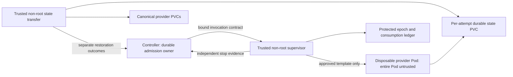

# Non-root execution authority — review proposal

The operator chose to retain the non-root rules on 2026-10-19. This proposal
changes execution topology for review; it is not an implemented or approved
rollout. The held-bootstrap candidate remains held. No provider dispatch or
historical hold release is enabled by this document.

## Decision and trust model

Use a disposable provider Pod for each admitted native run or auxiliary
operation. A run may contain multiple journalled SSH commands, but its Pod is
never reused for the next admission. Treat every process in that Pod, including
the SSH daemon and its initial processes, as untrusted. Provider code remains
UID 1000, with a read-only image, dropped capabilities, no host access, no
Kubernetes credentials and bounded network/resources.

Place the trusted execution supervisor Module in a separate control namespace.
It runs non-root under a distinct UID, without provider code, plugins or mutable
user workspaces. Only this Module mounts its persistent epoch/consumption ledger
and receives narrowly scoped execution-namespace Kubernetes credentials. A
separate state-transfer Module handles canonical state without running provider
code. Their small Interfaces hide fencing and restoration mechanics from native
admission callers; the controller retains the admission/release decision.

The two arrows to attempt state describe sequential ownership. The transfer
Module and provider must never have concurrent mutable access. Storage access
modes alone do not establish that fence.

| Module | Authority and data | Excluded from its Interface/runtime |
| --- | --- | --- |
| Native admission | Database ownership, scope budgets, release predicate | Arbitrary Pod manifests; trusting provider stop assertions |
| Execution supervisor | Exact-template launch, epoch consumption, exact Pod observation/stop | Model code, arbitrary control commands, canonical auth/workspaces |
| State transfer | Typed staging/restoration, version comparison, independent outcomes | Provider CLI, shell profiles, Git hooks, user configuration execution |
| Provider execution | One admitted run/operation and its staged state | Supervisor ledger/keys, canonical PVCs, service-account token, cluster access |

A rootless sidecar that only protects an epoch file is insufficient. A provider
sharing UID 1000 with the daemon could affect surviving daemon processes or future
launch behavior. Process-list absence and provider-local receipts cannot prove
that the persistent execution environment has become safe. The stronger Seam is
the complete disposable provider Pod, with stop evidence obtained outside it.

## Supervisor Interface and invariants

Expose three typed operations: `authorizeInvocation(contract)`,
`stopAndInspect(owner)`, and `inspect(owner)`. An Adapter translates these to the
existing transport; callers do not receive generic Kubernetes or shell access.
There is no `markStopped`, `clearHold` or unauthenticated `setEpoch` operation.

The contract binds instance/policy hash, company, agent, native run or auxiliary
operation, environment/lease, reservation attempt, invocation, command hash,
logical runner family and controller epoch. The supervisor chooses an approved
template and binds its physical Pod UID, container ID, node and storage
incarnation. Model-generated identifiers or paths cannot select another owner.

Before any executable command, commit the database journal, then durably consume
the exact invocation in the supervisor ledger. An ambiguous response is inspected;
it never causes body replay. Duplicate requests return the same durable outcome
or a held/uncertain result. Old epochs cannot launch or change a newer owner's
resources. A new epoch acknowledgement authenticates the supervisor and binds its
ledger incarnation, physical pool and exact approved configuration; provider-file
readback cannot create that acknowledgement.

An SSH compatibility Adapter may use a rootless gateway with a fixed entrypoint
and protected host key. It relays fixed argv to the exact attempt Pod and never
evaluates provider commands in the trusted gateway. The provider Pod's SSH server
is untrusted; its receipts remain diagnostic. Revoke the old direct runner keys
and network route during reviewed migration so an older controller cannot bypass
admission through the previous SSH endpoint.

`stopAndInspect` returns either independently confirmed termination for the exact
incarnation or an uncertain result that preserves occupancy. SSH disconnect,
Pod disappearance, deletion timestamp, node loss and force deletion are not
termination proof. Implementation must demonstrate a supported runtime/node
observation that confirms every container stopped; if Kubernetes status cannot
establish that fact, retain the hold until independent operator/node evidence
exists. Do not grant cluster-wide node authority merely to make this check pass.

## Kubernetes authority containment

Keep control and execution namespaces separate. The supervisor's role is limited
to required Pod and attempt-storage operations in the isolated execution
namespace, with no exec, secrets, nodes, controller/database access or escalation.
Exact permissions and storage provisioning remain a manifest review item.

Pod creation permission alone is too broad: RBAC does not constrain a submitted
Pod's service account, volume references or security settings. An independently
managed admission guard must reject anything outside approved image digests,
fixed service account with token automount disabled, non-root security settings,
bounded resources, allowed attempt volumes and owner identity. Reject host mounts,
privileged settings, arbitrary Secret/PVC references and extra containers.
The execution namespace contains no canonical credential or controller/database
Secrets. Quotas bound total Pods/storage even if the supervisor misbehaves.

Network policy allows the controller's authenticated control route, required
callback traffic and approved public provider egress. Provider Pods cannot reach
the supervisor control endpoint, Kubernetes API, unrelated internal services or
another attempt. Policy behavior and admission enforcement need negative tests
on the actual cluster before rollout; names and labels alone are not proof.

## State-transfer Interface and restoration

Expose `stage(contract)`, `restore(owner, stopEvidence)` and `inspect(owner)`.
Staging returns a versioned snapshot identity; restoration returns separate
workspace, session and credential outcomes. No caller supplies arbitrary host
paths or marks an outcome successful. Release requires confirmed whole-Pod stop
and all required restoration outcomes for the same owner and source versions.

Retain durable canonical state on the existing provider PVCs. Give execution a
durable per-attempt copy, never the canonical volume. EmptyDir alone cannot meet
uncommitted-work recovery requirements. Quarantine divergent copies and preserve
them through restart; do not destroy the only recovery copy on Pod deletion.
Storage detach/ownership and source-version checks must precede trusted mounting.

The transfer Module uses bounded file operations with symlink/archive traversal
checks. It must not source profiles, invoke user scripts or run Git helpers/hooks
from restored state. If repository execution is needed, it belongs in untrusted
execution, outside canonical credential mounts. Treat all returned files as
untrusted even after their provider process stops.

Codex's contract includes controller auth source, company symlink/cache, runner
default auth and every staged auth/session destination. Claude includes both
`.claude` and `.claude.json`, encoded workspace/session identity and resume
targets. Record storage IDs, canonical paths, modes and composed configuration
fingerprints. A topology change must retain the existing runner/account/state
scope families; new Pods cannot mint new scope keys to evade A's occupancy.

Credential restoration uses compare-and-set versions and preserves divergence.
It must never replace a newly refreshed token with an older backup. Separate
runner logins and the operator's no-later-copies statement do not prove provider
grant independence. Keep cluster credential scopes exclusive; account budgets
include this active laptop. Phone/other clients are currently idle. The review
envelope remains ten serial tasks per provider, proposed ten minutes per task and
two hours per stage, zero automatic body retries and no paid fallback. Actual
provider allowance and laptop consumption must be checked before dispatch.

## Legacy reconciliation and migration

Preserve every legacy hold, including unknown/global occupancy, until classified.
For A, bind a present-day operator decision to the original company/agent/run/
lease and immutable evidence hash. Stop or retire the old physical runner
incarnation using independent evidence, disable its old launch route, and restore
each required state destination. Record these facts as a new evidence type, never
as a fabricated historical receipt. A supported native lifecycle re-evaluation
must consume that evidence; do not edit pausing/manual state directly.

Initial executable limits remain one global attempt and one per provider/account/
state scope, with at most four pending requests. Gemini is unconfigured. Existing
B may run only after all shared legacy occupancy is resolved through the reviewed
path. Codex serial acceptance precedes Claude lifecycle/session/refresh checks;
overlap remains a separate gate.

Before implementation activation, review the exact namespace/RBAC/admission-guard,
storage/retention, network, image, policy and manual-migration diff. Rehearse on a
restored disposable clone: stop old controller, block old SSH routes, migrate,
start held, authenticate protected epoch acknowledgement, reconcile exact legacy
owners, then admit only the reviewed serial owner. A held-bootstrap source pass
does not validate this topology or its stop proof.

Restart must rediscover in-flight Pod/storage incarnations from protected ledger
and database journals before launch is possible. Lost ledger, epoch reuse,
unknown Pods or missing state retain holds. An older controller cannot be started
with outstanding admission work. Downgrade needs proven drain/compatibility or a
coordinated Paperclip-only database/files/config restore with dispatch blocked;
never restore the shared PostgreSQL cluster or delete PVCs/hold rows as rollback.

## Required proof before a workload proposal becomes executable

Use synthetic CLI/auth and disposable state first. Test provider attempts to
tamper with control keys/ledger/processes, old-key/old-controller bypass, duplicate
invocations, lost acknowledgement, epoch ABA, wrong owner/Pod/lease binding and
supervisor restart. Exercise node partition, forced deletion, disconnected SSH,
storage attachment loss and restoration failure; each ambiguous case must stay
occupied. Test admission-guard/RBAC negatives with deliberately forbidden Pods.

Demonstrate version conflicts and refresh divergence without credential loss,
independent workspace/session/credential outcomes, exact original scope-key
preservation, fair bounded waits, and failure recovery with the global limit one.
Only after a reviewed rollout and legacy resolution perform the ten-task serial
provider stages. The present candidate contains none of this new execution
topology, protected acknowledgement or reconciliation release implementation.
